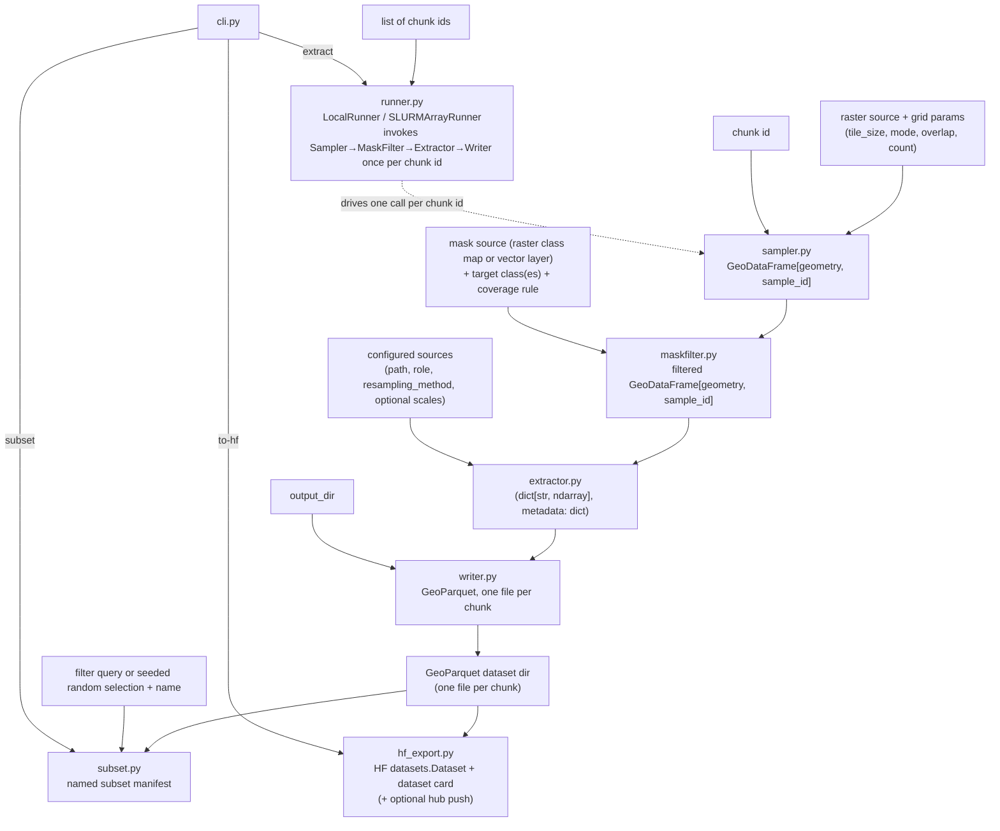

# Architecture

This document explains how geotables is put together and why, so anyone picking up an issue understands the reasoning behind the pieces around theirs, not just their own corner.

## Design principles

**Sample design is a first-class, recorded object, not an implementation detail.** Every chip carries the parameters that produced it — sampling method, source provenance, resampling choices — so a dataset is self-describing rather than something you have to reverse-engineer from a script someone ran once.

**Subsets of a dataset are named, trackable things.** Experiments reference a subset by name (`urban_v1`) and get back exactly how it was defined — a filter, a seed, a parent dataset — not a one-off query someone forgot the parameters of. This is the actual point of the project, not a bolt-on feature.

**Tables, not platform-specific formats.** Output is GeoParquet. No proprietary container, nothing that only works inside one vendor's notebook environment. An optional Hugging Face `datasets` export exists because that's a common consumption path, not because the canonical format depends on it.

**Resampling has no implicit default.** If a source needs reprojecting or resampling to align with others, the method is a required, explicit, logged choice. Silent defaults are how you end up debugging a model six months later and discovering the training data was quietly resampled with the wrong method.

## Pipeline stages

The core pipeline is six decoupled stages, each a pure function of its inputs — no shared state between them. That's deliberate: it's what lets different people work on different stages without coordinating constantly, and what lets the orchestration layer (below) swap out without touching any of this.

1. **Sampler** — turns a raster source + grid parameters into a GeoDataFrame of candidate sample geometries covering the full study area. The grid isn't clipped to the raster's actual bounds; edge geometries can extend past them on purpose (see Extractor).
2. **MaskFilter** — an optional, cheap pre-pass that filters candidates by a class criterion (e.g. "keep only urban") against a raster map or vector layer, before the much more expensive extraction step runs on them.
3. **Extractor** — reads each candidate's window from every configured source, resampling to a common resolution where sources differ natively, and stacks or names the results as output columns. Reads are boundless: a chip extending past a raster's edge gets padded with that source's nodata value rather than dropped or shifted, so the study area stays fully covered with zero gaps and every chip comes out the same shape. Each chip records what fraction of it is real data versus padding.
4. **Writer** — streams chips to GeoParquet, keyed by chunk so that re-running a chunk overwrites cleanly instead of duplicating.
5. **Dataset card writer** — for the optional Hugging Face export path, generates the metadata (bbox, CRS, resolution, sampling method, license) that most geospatial datasets on the Hub are missing.
6. **SubsetManager** — operates on an already-extracted table, not during extraction. Defines a named subset by a filter or a seeded random selection, and persists it as its own manifest: parent dataset, selection definition, seed, row count, timestamp.

## Orchestration

The chunk-processing core (Sampler slice → MaskFilter → Extractor → Writer) doesn't know or care how it gets invoked — it's a pure function of a chunk id. That's what makes the orchestration layer a thin, swappable `Runner`:

- **`LocalRunner`** — multiprocessing, for development and CI.
- **`SLURMArrayRunner`** — the actual production target. Submits a SLURM job array where each task handles one chunk and writes its own shard. Resumability lives in the chunk function itself (skip if the chunk's output already exists and is marked complete), not in the runner, so it applies no matter which runner is used — a failed array task is just a normal SLURM re-run.

I considered building this on Dask instead of directly on SLURM. Decided against it: the workload has no shuffles or joins between samples — it's embarrassingly parallel — so a second-level task scheduler on top of SLURM's own scheduler would have added a dependency and a layer of indirection without solving a problem that exists. The `Runner` abstraction is exactly what keeps this decision cheap to revisit: a `SparkRunner` or `DaskRunner` for users who already run those clusters (common on cloud data platforms) is a new, isolated Runner implementation later, not a rework of anything above.

## Data flow diagram

Visual version of [`DATAFLOW.md`](./DATAFLOW.md)'s table — regenerate this whenever that table changes, same discipline `scripts/check_dataflow.py` enforces between the table and the code, just applied by hand since a diagram isn't something CI can check automatically. Nothing below is built yet (all of #1-#10 are still open); this is drawn now because the contracts in `DATAFLOW.md` already exist and reviewing the shape of the pipeline doesn't need working code first.

## Result-level flows

The diagram above is the whole pipeline. For any one output artifact, that's more detail than needed and hides a question the pipeline diagram can't answer: exactly which functions and which intermediate values feed *this* result? Each deliverable-level artifact (the GeoParquet dataset, a named subset manifest, the HF export) gets its own flow diagram here, added in the same PR that implements the code producing it — same plain-box Mermaid convention as above, rendered to SVG locally to confirm the syntax before pushing. None exist yet since nothing's been implemented; the first one goes here once #4 (LocalRunner + CLI, the first end-to-end extract run) ships.

## What's deliberately not in v1

Feature-table output (one row per pixel instead of per chip), stratified/spatially-balanced/space-filling-curve sampling beyond grid and class-filtered selection, NetCDF/HDF/Zarr input sources, Delta Lake/Iceberg writers, write-back of model predictions to a georeferenced mosaic, and WebDataset export are all out of scope for the first working version. The architecture doesn't foreclose any of them — the decoupled stages and the Runner abstraction exist partly so they can be added later without rearchitecting — but v1 is deliberately the smallest slice that proves the core idea end to end.
